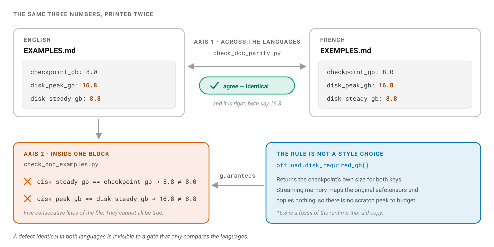

# Contributing

Thanks for your interest. This file documents how the project is maintained and what to expect.

## Versioning

This project follows [Semantic Versioning 2.0.0](https://semver.org/spec/v2.0.0.html).
Given a version `MAJOR.MINOR.PATCH`:

- **MAJOR** bumps when the public API changes in a way that breaks existing callers: function removed,
  signature changed incompatibly, return type changed, exception class changed.
- **MINOR** bumps when functionality is added in a backwards-compatible way: new function, new optional
  parameter, new optional dependency.
- **PATCH** bumps for backwards-compatible fixes only: bug fixes, internal refactors, packaging fixes.

Names starting with `_` are private and may change between any two releases without a MAJOR bump.

## Code standards

Every Python file follows the mandate in [CODING.md](CODING.md):

1. NumPy-style docstrings on every function and class (including private ones).
2. Full type annotations; `from __future__ import annotations` in every file.
3. Comments explain the *why*, not the *what*.
4. No bare `print(...)` in library code; use `click.echo` or `sys.stderr.write` in the CLI layer.
5. `EXAMPLES.md` stays runnable: every recipe is tested in CI.
6. One shared core behind every surface: library, CLI (`cli.py`), GUI + HTTP API (`api.py`), and MCP (`mcp.py`) all delegate to the same application logic.
7. Every GUI-visible string and human-language prompt resolves through [`locales/i18n.yaml`](locales/i18n.yaml).

Run the gate before opening a pull request:

```sh
pip install -e "." -r requirements-dev.txt
./scripts/gate.sh
```

That script *is* the gate. CI calls it one stage at a time (`deps`, `lint`,
`types`, `tests`, `version`) so a failure is named by the step that failed, and
the pre-push hook calls it whole. There is no second list of commands to keep
in sync with it, which there used to be: this file, the hook and the workflow
each described the gate in their own words until they disagreed, and a hook
that promises "a red local state never reaches CI" is worth nothing once it
runs something CI does not.

Individual stages, when you want one:

```sh
./scripts/gate.sh lint       # ruff check + ruff format --check
./scripts/gate.sh types      # mypy
./scripts/gate.sh tests      # pytest + the 90% coverage floor
./scripts/gate.sh package    # build a wheel + sdist and inspect them
```

CI runs the gate on Python 3.12 (a deliberately super-light single-version
lane; run the full 3.10-3.12 sweep locally before pushing). A failing check or
a coverage drop below the floor blocks the merge.

`package` is not part of the default sweep and not part of the per-commit CI
lane. Building a distribution catches packaging faults (missing package data,
invalid metadata, a Git-LFS pointer stub shipped in place of the ONNX model)
and none of those can be caused by editing a function body, so a separate
`packaging` workflow runs it when a packaging input actually changes, and on
demand. It builds and inspects; it publishes nothing.

## What the documentation gates check

Three of the gate's tests judge the documents rather than the code, and they
guard two axes: the two copies against each other, and the document against
the program it describes.



`scripts/check_doc_parity.py` compares `README.md`, `EXAMPLES.md` and
`LANDSCAPE.md` against their French twins: headings, fenced blocks, shell
flags, link targets, fence sizes, tables. It compares the *skeleton* and never
the wording, so a translated argument is never a breach and a section promoted
on one side only always is.

`scripts/check_doc_examples.py` compares the numbers inside one fenced block
against each other: `disk_steady_gb` against the `checkpoint_gb` printed beside
it, `seconds_per_token` against `est_tokens_per_s`, a `lightweight` descriptor
against the fact that the backend is a library with no port. Every rule holds
on any machine. Nothing is re-run and nothing is measured here, because a
worked example cannot be held to this developer's hardware.

The second gate exists because the first cannot see a defect the two languages
share. `EXAMPLES.md` and `EXEMPLES.md` both printed a `disk_peak_gb` of 16.8
for a checkpoint of 8.0, which is the signature of a runtime that copies the
file to scratch before running. This one has copied nothing since layer
streaming began reading the original safetensors. Parity called the two blocks
identical and was right.

`tests/test_doc_commands.py` is the second axis again, on the command line
instead of the numbers: it walks every `best-engine-ai-helper ...` line in the
root documents through the real Click tree, subcommand chain first, then every
long option against the leaf command that would receive it. It is a test
rather than a third script because a check of the command line has to import
the command line, and the other two stay dependency-free so the lightest CI
lane can run them with nothing installed.

It found the same blind spot on the same day. Both `README.md` and
`LISEZMOI.md` printed `lightweight plan --kind llm --compression 4bit`, a flag
Click refuses outright, while the README explains forty-four lines below that
the flag does not exist. Parity compares shell flags, found the two blocks
equal, and was right about that too.

The two scripts run on their own:

```sh
python scripts/check_doc_parity.py      # exit 0 = the pairs agree
python scripts/check_doc_examples.py    # exit 0 = the examples are coherent
```

## Writing standards

English prose (README, EXAMPLES, docstrings, comments) follows [references/WRITING.md](references/WRITING.md).
French prose (LISEZMOI, PAYSAGE) follows [references/ECRITURE.md](references/ECRITURE.md).

Key rules for both:

- No punctuation dashes (no em dash, no en dash used as an aside). Rewrite with commas, colons,
  semicolons, or parentheses.
- No machine tells: no "Moreover", "Furthermore", "crucial", "game-changer", "In conclusion".
- Acronyms: plain-language gloss first, then the term, then the abbreviation.

## Releases

Releases live in [CHANGELOG.md](CHANGELOG.md), tagged `vX.Y.Z` in git, and published as GitHub releases.

## Pre-push hook

A git `pre-push` hook runs `scripts/gate.sh` and blocks the push outright if
any stage fails: a red local state never reaches CI. It decides *where* the
gate runs, not what it checks, so it cannot drift away from the workflow.
One-time setup per clone:

```bash
git config core.hooksPath .githooks
```

Bypass only when you really mean it: `git push --no-verify`.

**It judges the commit you are pushing, not your working directory.** The hook
checks that commit out into a throwaway worktree and runs the gate there, which
matters in both directions:

- A file you have not committed cannot fail your push. That includes files
  belonging to somebody else working in the same tree — three concurrent
  sessions blocked each other this way before the hook was changed.
- A lint error you have committed cannot pass because you already fixed it on
  disk. The old hook read the fixed file while the broken one was what went
  out, which is the quieter and worse of the two faults.

So a green gate describes the commit, not your editor. When the two differ the
hook says so, and your uncommitted work is neither tested nor pushed — commit
it if you want it gated.

This costs one detached checkout per push. If a repository ever needs a
gitignored file to run its tests, the gate will fail loudly rather than skip
quietly; that is the right way round, but it is worth knowing before you go
looking for the cause.

## Authorship

Sole author: [Warith Harchaoui](https://www.linkedin.com/in/warith-harchaoui/).
External contributions are welcome. Open an issue or pull request on GitHub.

## License

[BSD-3-Clause](LICENSE).
