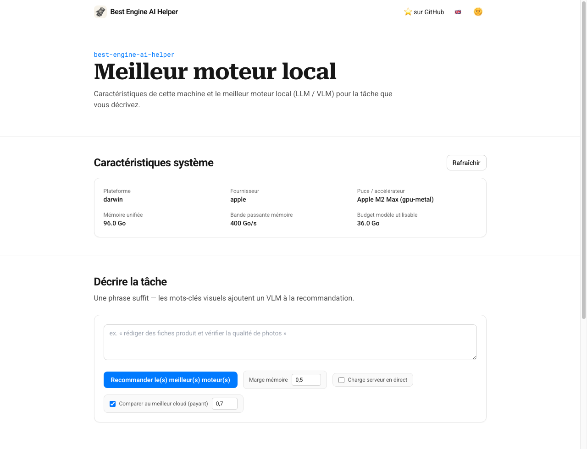
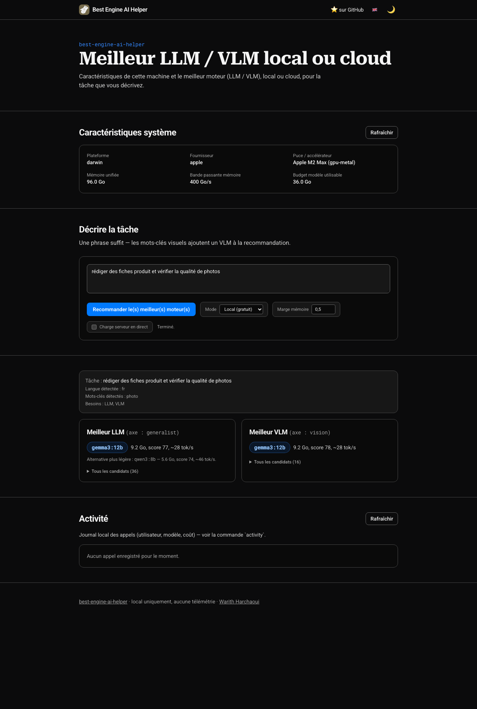
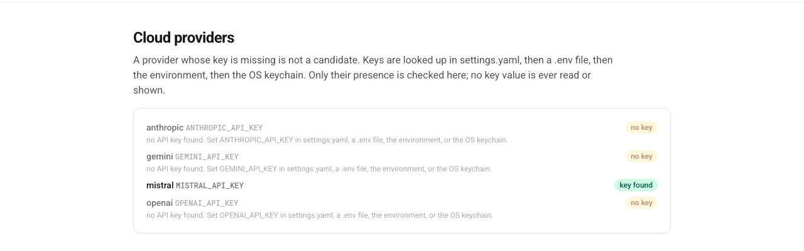
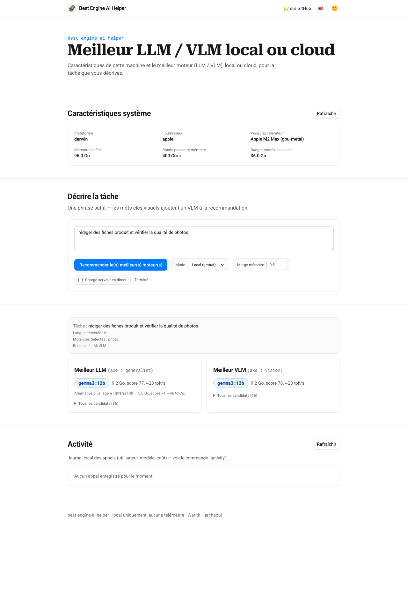
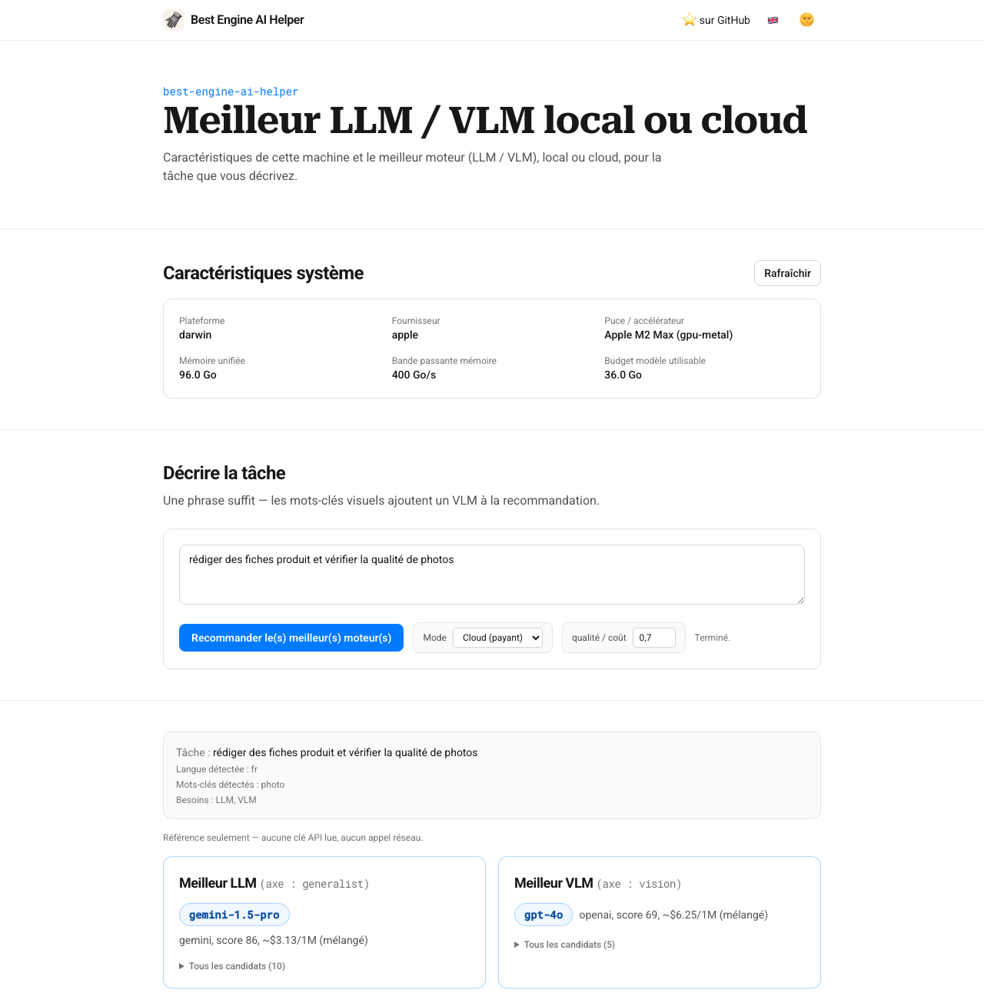

# GUI: Best Engine AI Helper

A minimal single-page GUI, served by a small FastAPI app, for the two things
you'd otherwise run `detect` and `report` for: seeing this machine's hardware,
and getting the best local engine(s) for a task description, without leaving
the browser.

Keeps the AI Helpers suite's house style: **vanilla JS + Tailwind (CDN), no
build step, no framework, no npm.** The GUI is a thin client over the same
library calls the CLI uses (`detect.available_memory()`,
`detect.compute_profile()`, `score.effective_budget()`, and
`recommend.recommend()`), so its numbers always match `best-engine-ai-helper
detect` / `report` run at the same moment.

**Look and feel** matches the [sprezzature-figures
gallery](https://sprezzature.ai/figures.html): Roboto /
Roboto Serif / Roboto Mono, the `#007aff` brand blue, a neutral gray scale,
and the same sticky-header / bordered-section rhythm. Light and dark both
ship; the 🌞/🌙 toggle in the header persists to `localStorage` and defaults
to the OS preference, matching `[data-color-scheme]` on `<html>`, resolved
before first paint so there's no flash.

| Light | Dark |
|---|---|
|  |  |

## Install and run

```sh
pip install best-engine-ai-helper
best-engine-ai-helper gui
# open http://127.0.0.1:8000/gui
```

`gui` is a thin wrapper around Uvicorn (`--host` / `--port` to change the
bind address). Equivalent, if you want the ASGI app directly:

```sh
uvicorn best_engine_ai_helper.api:app --port 8000
```

## Language

The page is bilingual (**French by default, English at `/gui?lang=en`**), with
a header link (a flag emoji, 🇬🇧 / 🇫🇷) that switches between them. Both are
rendered from a single template by `gui.render_gui(lang)`; every string comes
from [`best_engine_ai_helper/locales/i18n.yaml`](best_engine_ai_helper/locales/i18n.yaml)'s
`gui:` namespace: that file is the one place to edit wording, add a language,
or check a translation, not `gui.py`. An unknown `?lang=` falls back to `meta.default_locale` (French)
rather than erroring. The JSON API is language-neutral, so only the labels
differ; the numbers are identical.

## What it shows

### 1. System characteristics (hardware snapshot)

Platform, vendor / chip, accelerator, memory bandwidth, and the usable memory
budget (`effective_budget`, after the Apple Metal GPU-usable cap and the safety
headroom; see the README's "How selection works"). A **Refresh** button
re-probes the machine without reloading the page, useful right after plugging in
an eGPU or closing memory-heavy apps.


### 1bis. Cloud providers, and why one is unavailable

One row per provider in the bundled price list, saying whether a key resolved
for it right now. A provider whose key is missing is **not a candidate** for the
cloud pick, and this is that rule made visible: unavailable rows are **dimmed
rather than hidden**, because the point is to show the rule being applied, not
to quietly present a shorter list of options as if it were the whole field.

Each unavailable row names the variable to set, and keys are looked for in
`settings.yaml`, then a `.env` file, then the environment, then the OS keychain.

Only *whether* a key resolved is ever reported. No key value is read, returned
or displayed — that is the reason engine descriptors store `api_key_env` (the
variable's name) rather than the secret, and the same rule holds here.



### 1ter. Too large to load, still runnable

What this machine could run by **streaming a model's layers off disk** rather
than loading it — see the README's [layer streaming
section](README.md#too-large-to-load-still-runnable-layer-streaming) for the
mechanism. The panel is deliberately four lines rather than a table, because
only four things decide the question:

- whether this machine has a runtime for it at all (a CUDA/ROCm GPU, or Apple
  Silicon through MLX), and whether the lightweight runtime actually imports — it is
  a core dependency, so a failure there means an incomplete install, and the
  panel prints the repair command rather than leaving a dead end;
- the **storage class and its read bandwidth**, labelled `measured` or
  `declared`, because the drive sets the entire speed of this backend;
- the **layer budget**: how much resident memory one decoder layer may occupy
  here, which is a different budget from the one above it (a transient layer
  does not pay the headroom a resident model does);
- the **biggest model it would actually run**, with the three figures that
  decide feasibility — resident gigabytes, seconds per token, and the free disk
  its checkpoint needs.

The last line is the verdict in prose, straight from the same policy the CLI
and `resolve` consult, so the page cannot disagree with them: usually "a model
already fits this machine, so streaming would trade two to three orders of
magnitude of speed for nothing".

Nothing is measured on page load. The disk probe writes and reads back ~256 MB,
which is not something a page view should do unasked, so the panel reads the
storage-class table and `GET /api/lightweight?measure=true` is opt-in.

### 2. Describe the task → best engine(s)

Type a free-text task (the same kind of phrase `report --task "..."` takes)
and the page shows the detected language, the matched keywords and benchmark
axis, then per model kind the task needs (LLM for text, VLM when anything
visual is mentioned): the chosen model with its RAM footprint / benchmark
score / estimated tokens per second, a lighter alternative when one is nearly
as strong, and the full ranked candidate table behind a disclosure toggle.
Leaving the box empty, or typing text with no detectable language (symbols or
digits only), logs a warning server-side and falls back to a generic
text-assistant profile; see `recommend.parse_task`.



A **mode** dropdown next to the button mirrors the brief's own `mode: local` /
`mode: cloud` switch (see the README's "Two modes: local (free) and cloud
(paid)"): only one mode's recommendation renders at a time, and its own
controls come with it.

- **Local** (default): the memory headroom field (default `0.5`, matching
  `report --headroom`) and the **live server load** checkbox (matches
  `report --live`: checked, the recommendation also weighs current free RAM,
  CPU/GPU/disk usage, and already-running engines, with an extra line
  showing that snapshot; unchecked, the recommendation is a deterministic
  function of the hardware alone).
- **Cloud**: the `quality_vs_cost` field (0..1, default 0.7: `1.0` picks
  purely on benchmark score, `0.0` picks purely on price) replaces them. The
  cloud pick is reference only: no API key read, no network call, just the
  bundled `pricing.yaml` catalog ranked the same way `report --cloud` ranks
  it.

  The candidate table carries a **`from`** column naming the measurement
  behind each score, because after a `catalog update --cloud --arena` the
  rows are no longer scored by one ruler: a `general` figure is a published
  MMLU-style suite result carried by hand, an `arena` one is a preference win
  rate adopted from a leaderboard, and both print out of 100 without being the
  same quantity. A model the leaderboard does not rate on the requested axis
  shows **`?`** rather than `0` — the mirror publishes a top twenty per board,
  so that absence is censorship, not weakness.



Switching modes re-runs the last query if one was already shown; the deep
link `/gui?task=...&mode=cloud` pre-selects a mode and runs immediately.

### 3. Activity (local call ledger)

Total calls, estimated total cost, error rate, and per-user / per-model
breakdowns from the local SQLite ledger (`~/.best-engine-ai-helper/usage.db`,
see the README's "Activity ledger"). Empty until something calls
`llm.chat()`, whether this tool's own `pull`/`validate` gates or any
downstream project that imports `best_engine_ai_helper.llm` and has
recording enabled. A
**Refresh** button re-fetches without reloading the page.

## HTTP surface

The GUI is a client of seven JSON endpoints, usable directly (e.g. from
another tool, or `curl`):

| Method | Path | Body | Returns |
|--------|------|------|---------|
| `GET`  | `/api/system` | (none) | hardware + compute profile + `memory_budget_gb` |
| `POST` | `/api/recommend` | `{"task": str \| null, "headroom": float, "live": bool, "cloud": bool, "quality_vs_cost": float, "cloud_provider": str \| null}` | the same report `recommend()` / `report` produce, as JSON, plus the best paid model under `"cloud"` (reference only) unless `cloud: false` |
| `GET`  | `/api/preferences` | (none) | saved preferences, defaults filled in |
| `POST` | `/api/preferences` | any of `quality_vs_cost`, `headroom`, `min_tps`, `local_only`, `live_load` | the full set as now saved, to `~/.best-engine-ai-helper/preferences.yaml` — never `settings.yaml`, which holds keys |
| `GET`  | `/api/providers` | (none) | one row per cloud provider: `provider`, `key_env`, `available`, `reason`, `models`. Never a key value |
| `GET`  | `/api/activity` | (none) | ledger summary: `total_calls`, `total_cost_usd`, `error_rate`, `by_user`, `by_model`, `recent_errors` |
| `GET`  | `/api/lightweight` | query: `measure` (bool, default false), `kind` (`llm`/`vlm`), `compression` (`4bit`/`8bit`), `answer_tokens` (int, default 300), `batch` (int, default 1) | layer streaming: `decision` (activate / trigger / reason / blockers), `disk` (class, read GB/s, basis, free GB), `memory_budget_gb`, `chosen`, ranked `plans`, and `comparison` — native model vs streamed model priced in seconds for the same answer |

```sh
curl -s http://127.0.0.1:8000/api/system | python3 -m json.tool

curl -s -X POST http://127.0.0.1:8000/api/recommend \
     -H 'Content-Type: application/json' \
     -d '{"task": "product descriptions and image-quality checks"}' \
  | python3 -m json.tool

# Is a too-large model worth the wait on this machine?
curl -s 'http://127.0.0.1:8000/api/lightweight?answer_tokens=300&batch=8' \
  | python3 -c 'import json,sys; print(json.load(sys.stdin)["comparison"]["verdict"])'
```

`GET /` redirects to `/gui`. `GET /docs` (FastAPI's default) has the full
OpenAPI schema.

### The OpenAI-compatible routes, on the same port

The same app also serves `/v1/models`, `/v1/chat/completions`,
`/v1/completions`, `/v1/embeddings` and `/v1/images/generations` — see the
README's [Use it as an OpenAI
endpoint](README.md#use-it-as-an-openai-endpoint). They are a different kind of
route from the seven above and the difference is worth stating: `/api/*` is this
package's own idiom and answers *decisions* (what hardware is this, which model
should run), while `/v1/*` is somebody else's protocol and *runs* the model.

Two consequences visible from the browser. The `/docs` schema lists both
families, so an OpenAPI client sees the whole surface. And the error shape
differs on purpose: `/v1` returns OpenAI's `{"error": {...}}` envelope because
an SDK reads `error.message`, while `/api` keeps FastAPI's `{"detail": ...}`
because its callers already expect that — a compatibility layer should not
change the conventions of the surface it sits beside.

## Icons

`assets/logo.png` (the engraved glove) is the source of every icon the page
serves: `favicon.ico`, 16/32 px favicons, `apple-touch-icon.png`, and the two
Android/PWA sizes referenced from `site.webmanifest`. All are generated,
never hand-edited, by `scripts/generate_icons.py`, which composites the logo
onto the suite's cream background (`#f7f3ea`) so it reads on light and dark
browser chrome alike. Re-run it whenever `assets/logo.png` changes:

```sh
python scripts/generate_icons.py
```

## What it deliberately doesn't do

- **No pull / validate from the browser.** `pull` downloads multi-gigabyte
  weights and runs the Ralph gates; that stays a deliberate, watched CLI
  action, not a button click.
- **No persistence.** Every recommendation is a fresh, stateless call; nothing
  is written to `~/.best-engine-ai-helper/` from the GUI.
- **No auth, no remote exposure by default.** `gui` binds to `127.0.0.1`.
  Passing `--host 0.0.0.0` is your call, not the default.
